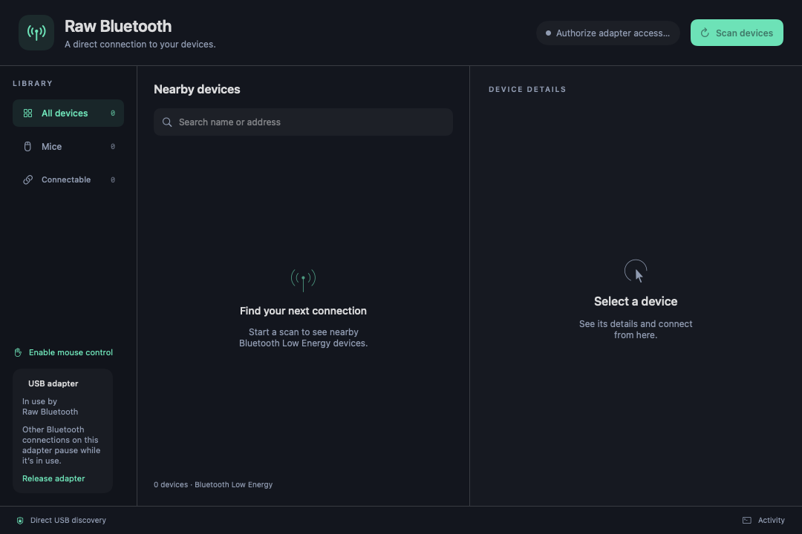

# Raw Bluetooth for macOS

Current version: **0.5.0** (build 8).

Use an external USB Bluetooth dongle to connect a wireless mouse and keyboard to macOS through a userspace Bluetooth stack.

Raw Bluetooth talks directly to the dongle over USB HCI, uses Google Bumble for Bluetooth discovery and pairing, and translates HID reports into native macOS input events. Pair devices inside the app, independently of System Settings. This is an experimental userspace driver; it does not install a kernel extension.

**Mouse and keyboard support is working on the development setup. System audio routing to Bluetooth A2DP/SBC devices is experimental.** The app captures macOS system audio and streams it to a discovered Bluetooth audio sink. Microphone input is not implemented.

## Install the compiled app

Download the Intel `.dmg` from [GitHub Releases](https://github.com/saikrishna488/raw-bluetooth/releases), open it, and drag **Raw Bluetooth** to **Applications**. The community preview bundles Python, USB libraries and FFmpeg; no Terminal setup or source checkout is needed.

This preview is ad-hoc signed and **not notarized**. If macOS blocks opening, use **System Settings → Privacy & Security → Open Anyway** after attempting to launch it. Grant **Accessibility** permission and approve the administrator request when starting a USB session. Requires Intel macOS 13+ and a supported external adapter; hardware compatibility still needs independent testing.

The installed app keeps pairing keys and preferences in `~/Library/Application Support/Raw Bluetooth`. Development-checkout pairings are not automatically migrated. See [installation and limitations](packaging/INSTALL.txt). Source setup remains available below.

### Build a distributable installer

On an Intel Mac with Xcode Command Line Tools, create a build environment and run:

```sh
python3 -m venv .venv
.venv/bin/pip install -r packaging/requirements-build.txt
.venv/bin/python packaging/build_release.py
```

The verified DMG and SHA-256 checksum appear in `dist/`. This does not replace your installed development app or use its local signing key. GitHub Actions builds and publishes a prerelease when the version or packaging changes on `main`; each published installer requires a new version. Developer ID signing and notarization are not automated in this preview.

## GUI preview



*Earlier development screenshot of the discovery screen. The current app also includes keyboard, saved-device, speed, and experimental audio controls described below.*

## Current support

| Capability | Status |
| --- | --- |
| BLE discovery and encrypted HID pairing | Implemented |
| Relative mouse movement, buttons, vertical/horizontal scrolling | Implemented; Logitech M196 verified on the development setup |
| BLE keyboards, modifiers, repeat, NKRO and common media usages | Implemented; Logitech K250 pairing workflow documented |
| Mouse and keyboard connected together | Implemented |
| Automatic recovery from temporary input socket congestion | Shared by all supported BLE mice and keyboards; regression tested |
| Saved devices and automatic reconnection | Implemented; requires an active app session and device advertising |
| Mouse and scroll speed controls | Implemented |
| Bluetooth Classic audio discovery | Implemented |
| System audio routed to a Bluetooth A2DP/SBC sink | Experimental; requires macOS system-audio recording permission and compatible audio hardware |
| Microphone input, HFP/SCO | Not implemented |
| Keyboard LED synchronization and vendor-specific Fn functions | Not implemented |
| Boot/login-screen input and guaranteed recovery after sleep | Not supported |

Other BLE HID devices may work, but this is not a general compatibility guarantee. Bluetooth Classic HID and proprietary receiver protocols are outside the implemented BLE HID path.

Mouse and keyboard reports are decoded from each device's HID descriptor rather than a brand-specific packet layout. Input forwarding and temporary socket congestion recovery use the same code for every device. Recovery retries packets in order, including key-up and button-up events. This does not establish compatibility with every Bluetooth mouse or keyboard; new models still need discovery, pairing, input, and reconnection checks on real hardware.

## Requirements

- macOS 13 or later, with a logged-in desktop session.
- Xcode Command Line Tools (`swiftc`, installed with `xcode-select --install`).
- Python 3.9 or later. The pinned environment was developed with Python 3.9; other versions need validation.
- An external CSR USB Bluetooth adapter with USB ID **`0a12:0001`** for the default transport.
- Administrator authentication to claim the USB adapter and Accessibility permission for input output.

The build script currently targets **`x86_64-apple-macosx13.0`**. Native Apple Silicon builds are not configured or validated. Sharing a USB ID does not guarantee identical dongle firmware or behavior.

The external adapter is exclusively occupied during a raw session. The default selection deliberately excludes the internal Lite-On `04ca:3018` radio. The Atheros firmware helper in the repository is not used by default adapter selection.

## Quick start

```sh
git clone https://github.com/saikrishna488/raw-bluetooth.git
cd raw-bluetooth
python3 -m venv .venv
.venv/bin/python -m pip install --upgrade pip
.venv/bin/pip install -r requirements-lock.txt
./gui/build.command
open "$HOME/Applications/Raw Bluetooth.app"
```

The build installs the app in `~/Applications` and creates a private local development signing identity in `.signing/`. It embeds the checkout path: keep this source directory and its `.venv` in place, and rebuild after moving it. This is a locally signed development build, not a standalone notarized installer.

1. Plug in the dongle and open **Raw Bluetooth**.
2. In **System Settings → Privacy & Security → Accessibility**, grant **Raw Bluetooth** permission.
3. Click **Scan devices** and authenticate in the administrator dialog.
4. Put the mouse or keyboard into Bluetooth pairing mode, select it, and choose **Connect mouse** or **Connect keyboard**.
5. For keyboard passkey pairing, type the displayed six-digit code on the keyboard being paired and press Enter.
6. Keep the app running. Use **Release adapter** when finished.

For an M196, hold its bottom pairing button for about three seconds until blinking. For a K250, hold its Bluetooth button until blinking. Pairing may take up to two minutes.

## Settings and background operation

Open **Settings** with the gear button, the app menu (⌘,), or the menu bar icon.

- **Launch at login** registers Raw Bluetooth with macOS Login Items. If macOS requires approval, open Login Items Settings from this page.
- **Start with the window hidden** opens the app without its main window. The menu bar icon remains available.
- **Connect saved devices on launch** starts an adapter session for devices with automatic reconnection enabled. Starting a new session may display an administrator prompt.
- **Keep running when the window closes** keeps device input and the authorized worker running after closing the main window. This defaults to on. Reopen from the menu bar icon or Dock. Turn it off to quit when closing the main window.
- **Scroll page length**, under **Settings → Scrolling**, sets 1–30 lines per vertical wheel step. It combines with the sidebar's Scroll Speed, applies immediately to all connected mice, and is saved across launches. The default is 1 line; applications control the actual height of a line. Horizontal scrolling keeps its existing speed.

**Quit Raw Bluetooth** stops the worker and releases the adapter. Background operation requires a logged-in user; it does not provide login-screen input or operation after logout.

This build does not offer permanent administrator authorization. It requests authorization when launching its USB worker and never stores your password. A persistent privileged service would require a separately packaged and approved helper. Keeping the app running avoids restarting the worker just to close and reopen its window.

## Documentation

- [User guide and command-line reference](docs/USAGE.md)
- [Architecture and repository map](docs/ARCHITECTURE.md)
- [Troubleshooting](docs/TROUBLESHOOTING.md)
- [Contributing and validation](CONTRIBUTING.md)

## Development checks

```sh
.venv/bin/python -m unittest -v test_hid_mouse.py test_hid_keyboard.py test_gui_backend.py
.venv/bin/pip check
```

The suite covers HID parsing, backend behavior, and input forwarding under temporary socket congestion for both mice and keyboards. Passing these tests does not establish hardware compatibility, Accessibility authorization, audio playback, or USB recovery on another Mac.

## Local data and privacy

Host identity, Bluetooth bonding keys, saved device preferences, logs, and signing material stay outside Git through `.gitignore`. Do not upload `.signing/`, `driver-identity.json`, `driver-bonds*.json`, or `saved-devices.json`. Review diagnostic output before sharing: scans and logs can contain device names, addresses, and input report data. Keyboard keypress contents are not written to the normal activity or driver logs.

## Dependencies and licensing

Bluetooth functionality uses [Google Bumble](https://github.com/google/bumble), pinned to `0.0.219`; the full Python environment is in [requirements-lock.txt](requirements-lock.txt). Experimental audio encoding uses FFmpeg through `imageio-ffmpeg`.

Bundled Atheros firmware retains its [vendor license](firmware/LICENCE.atheros_firmware), with origin URLs and SHA-256 hashes in [firmware/manifest.json](firmware/manifest.json). Those terms apply to the firmware. This repository does not currently declare a license for its original source code.

### C++ HID decoder

Build the native parser and decoder using the same Python interpreter that runs
Raw Bluetooth (requires Xcode Command Line Tools on macOS):

```sh
.venv/bin/python native/build.py
.venv/bin/python -m unittest discover -v
.venv/bin/python native/benchmark.py
```

The backend automatically uses the compiled C++17 extension when present. Rebuild
it after changing Python versions or CPU architecture. Set
`RAW_BLUETOOTH_PYTHON_HID=1` to select the Python reference implementation.
Without the extension, source checkouts continue using Python. Release builds
compile and bundle the native decoder and verify its selection during self-test.

This is a partial native migration: HID descriptor parsing and per-report field
extraction/decoding run in C++; keyboard state aggregation and Bluetooth session
management still use Python/Bumble. The desktop UI and input output use Swift.
The benchmark measures decoding only, not end-to-end input latency. USB pairing,
A2DP, and packaged app installation still require hardware testing.

For experimental system audio routing, select a Classic audio device and choose **Route system audio**. macOS may ask for Screen & System Audio Recording permission. **Disconnect audio** stops the route. Audio output quality and latency depend on the adapter and A2DP sink; microphone input is not provided.
