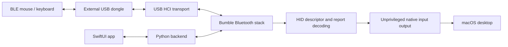

# Architecture

Raw Bluetooth owns an external USB controller for the duration of a session. It bypasses CoreBluetooth and System Settings pairing for its own connections; native macOS input output still uses the logged-in desktop session and Accessibility authorization.

## Desktop session

`gui/RawBluetooth.swift` presents discovery, connection state, pairing prompts, saved devices, and speed controls. After one-time USB service installation, it launches `gui_backend.py` as the desktop user. Without the service, it retains per-session administrator authorization. Commands travel through a session command file; discovery and status events return through JSONL. The native app receives input reports through its pointer server and posts native mouse/keyboard events without running the GUI as root.

The backend uses `adapters.select_transport()` to select a single external standard USB HCI adapter or validate an explicit VID/PID. It reads macOS USB topology, excludes internal/unknown controllers and duplicate identities, and checks the HCI interface and event/ACL endpoints without claiming the controller. Vendor firmware loading is not provided. The desktop app stores an optional USB ID selection in UserDefaults. The backend then opens Bumble's HCI transport, and creates a Bluetooth device with the persisted host identity. It handles BLE advertisements, Classic inquiry, pairing, connections, and reconnection scheduling. Input connections discover the HID service, parse its report map, and subscribe to relevant report characteristics.

The GUI provides a menu bar icon and can keep running after its main window closes. This preserves the worker and native input output in the logged-in user session. Startup and background preferences are stored in macOS UserDefaults; launch at login is registered through `SMAppService.mainApp` and remains subject to macOS approval. Settings can install a persistent privileged C++ USB broker (`native/usb_service.cpp`) from the packaged app. `usb_service.py` is now only its unprivileged Bumble transport adapter. The installer copies its complete runtime to a root-owned directory under `/Library/PrivilegedHelperTools`, rejects external symlinks, and registers a launchd daemon. An owner-only Unix socket and kernel peer credentials restrict access to the installing account. Requests accept only validated external USB VID/PIDs and HCI packets; no user paths, app commands, pairing files, or input output run in the broker. Only one client can claim USB at a time. Disconnect closes the USB transport. Reinstall after updates; installation and removal require administrator approval.

The GUI renews a heartbeat on a dedicated dispatch queue, independently of UI polling. An activity token prevents App Nap throttling during an adapter session while allowing normal system sleep. The worker stops after a lease expires if the GUI crashes or disappears; normal shutdown disconnects peers, attempts a controller reset, and releases the USB transport. Session events record heartbeat expiry, an explicit Stop command, or a shutdown signal. This cleanup is best effort: USB resets and deep sleep can still require manual recovery.

## Input decoding

Mouse parsing honors report IDs, signed/bit-packed values, relative movement, buttons, and wheels. Absolute axes are excluded from pointer forwarding. Keyboard parsing covers standard key arrays, NKRO bitmaps, modifiers, and common consumer/media usages. The native output implementation handles keyboard repeat.

Both pointer output paths clamp movement and click positions to the nearest active display in CoreGraphics coordinates. They use individual display rectangles to handle negative origins and gaps between monitors. Movement beyond a display edge is discarded; posted movement deltas reflect the distance actually traveled. The GUI also clears fractional movement on clipped axes so reversing direction responds without accumulated off-screen motion.

The CLI uses `pointer_bridge.py` and `pointer.py` instead of the native GUI output path. The Bluetooth process can run as root while the pointer helper stays in the desktop user's session.

Input socket delivery retries temporary macOS datagram buffer exhaustion in order, without marking the output helper permanently disconnected. Connection cleanup still disconnects the Bluetooth peer if releasing input state fails.

## Audio path

`audio_stream.A2DPTestTone` opens a Classic BR/EDR connection, authenticates and encrypts it, discovers an SBC A2DP sink through AVDTP, and streams encoded test audio. FFmpeg generates a stereo 440 Hz tone at 44.1 kHz and encodes SBC; Bumble packages and sends it. There is no CoreAudio virtual device, system audio capture, or HFP/SCO microphone implementation.

## Repository map

| Path | Responsibility |
| --- | --- |
| `gui/RawBluetooth.swift` | Desktop UI and session control |
| `gui/PointerServer.swift` | Native input report server and mouse output |
| `gui/KeyboardOutput.swift` | Native keyboard output |
| `gui/build.command`, `gui/sign_app.py` | Build, install, and locally sign the desktop app |
| `gui_backend.py` | Unprivileged Bumble protocol bridge and async session commands |
| `m196_driver.py` | Host configuration, BLE pairing, HID subscriptions, mouse CLI |
| `hid_mouse.py`, `hid_keyboard.py` | HID decoding |
| `adapters.py` | Default external adapter selection and bond maintenance |
| `saved_devices.py` | Device preferences and persistence |
| `pointer.py`, `pointer_bridge.py` | Separate CLI pointer output |
| `audio_stream.py`, `audio_cli.py` | Experimental A2DP test tone and audio diagnostics |
| `raw_scan.py` | Low-level USB HCI scanner |
| `scan.swift` | Earlier CoreBluetooth scanning utility, separate from the raw path |
| `atheros_adapter.py`, `firmware/` | Internal Atheros firmware helper/assets; excluded from automatic raw selection |
| `test_*.py` | HID and backend unit checks |
| `requirements-lock.txt` | Pinned Python dependencies |

## Persistent local state

| Location | Contents / handling |
| --- | --- |
| `driver-identity.json` | Generated host address and identity resolving key; keep private |
| `driver-bonds.json` | Bluetooth pairing keys; keep private |
| `driver-bonds.pre-dual-adapter.json` | Bond migration backup; keep private |
| `saved-devices.json` | Saved device information and reconnection preferences |
| `.signing/` | Dedicated local signing keychain, certificate, and password |
| `*.log`, `*.hex`, `*.sock`, `pointer.ready`, `driver.stop` | Runtime diagnostics, reports, IPC, and stop/readiness markers |

Identity, bonds, and preferences are created with owner-only permissions. The normal-user worker owns state after USB service installation; legacy per-session administrator mode can leave root-owned files. The installer migrates known state ownership, and diagnostic dumps use nonfatal atomic replacement. Bond keys are not included in GUI status events. The CLI scanner and mouse diagnostics can expose addresses and reports, so review logs before attaching them to an issue.

The signing certificate is pinned in the app's designated requirement so the identity stays stable across builds. Preserve `.signing/` locally to retain that identity and associated Accessibility authorization. A fresh checkout creates its own identity. The build temporarily adds its dedicated keychain to the user search list and restores the previous list afterward.

## Distributable builds

`packaging/build_release.py` builds the Swift frontend and a nested PyInstaller worker app. The worker includes its interpreter and USB dependencies. FFmpeg is built from checksum-pinned upstream source with only the LGPL test-tone components; the development environment's imageio FFmpeg binary is excluded. Source archives, build options and third-party notices accompany the bundled libraries.

Installed builds select `Contents/Helpers/backend.app` rather than a source checkout. The GUI creates `~/Library/Application Support/Raw Bluetooth` as the logged-in user and passes it explicitly to the authorized worker. Identity, bonds, report maps and saved-device data are kept there. Source builds retain their checkout-local state. The installer contains neither private runtime state nor the local development signing identity.

The DMG uses ad-hoc signatures and is not notarized. Release verification mounts it read-only, checks signatures and package contents, and exercises backend imports, the bundled USB library and FFmpeg without a checkout or Python on PATH. Hardware pairing and permission prompts still require manual testing on a separate Mac.

## Native HID implementation

`native/hid.cpp` implements descriptor parsing and mouse/keyboard report decoding
in C++17, exposed through the CPython API. A capsule owns each parsed descriptor;
report decoding reads at most five bytes per field, including unaligned 32-bit
values, rather than converting the entire report into an arbitrary-precision
integer. Descriptor dimensions, total report bits and field counts are bounded.
`native_hid.py` preserves field metadata and keyboard state across report IDs.
`hid_backend.py` selects the extension, or the Python reference implementation
when it is absent or explicitly disabled. A present but broken native extension
fails visibly rather than silently switching implementations.

`native/build.py` compiles the HID and backend modules for the running Python interpreter, plus the standalone C++ USB broker. There are no
additional runtime libraries beyond the C++ standard library and Python.
`test_native_hid.py` reuses the existing HID contract tests and compares all field
widths and alignments against Python; `native/benchmark.py` compares decode
throughput. The Bluetooth protocol stack remains Bumble, so the worker continues
to require its Python runtime and dependencies.

## C++ backend and bridge

See [Native backend and Bumble bridge](NATIVE_BRIDGE.md) for the migrated components, privilege boundary, compatibility, and build instructions. The privileged broker runs without Python; Bumble protocol orchestration remains in an unprivileged bundled Python worker.
