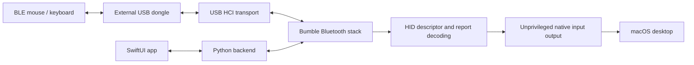

# Architecture

Raw Bluetooth owns an external USB controller for the duration of a session. It bypasses CoreBluetooth and System Settings pairing for its own connections; native macOS input output still uses the logged-in desktop session and Accessibility authorization.

## Desktop session

`gui/RawBluetooth.swift` presents discovery, connection state, pairing prompts, saved devices, and speed controls. It launches `gui_backend.py` with administrator authorization for USB access. Commands travel through a session command file; discovery and status events return through JSONL. The native app receives input reports through its pointer server and posts native mouse/keyboard events without running the GUI as root.

The backend uses `adapters.select_transport()` for default selection, opens Bumble's HCI transport, and creates a Bluetooth device with the persisted host identity. It handles BLE advertisements, Classic inquiry, pairing, connections, and reconnection scheduling. Input connections discover the HID service, parse its report map, and subscribe to relevant report characteristics.

The GUI provides a menu bar icon and can keep running after its main window closes. This preserves the worker and native input output in the logged-in user session. Startup and background preferences are stored in macOS UserDefaults; launch at login is registered through `SMAppService.mainApp` and remains subject to macOS approval. The app does not install a persistent privileged helper.

The GUI renews a heartbeat. The worker stops after a lease expires if the GUI crashes or disappears; normal shutdown disconnects peers, attempts a controller reset, and releases the USB transport. This cleanup is best effort: USB resets and deep sleep can still require manual recovery.

## Input decoding

Mouse parsing honors report IDs, signed/bit-packed values, relative movement, buttons, and wheels. Absolute axes are excluded from pointer forwarding. Keyboard parsing covers standard key arrays, NKRO bitmaps, modifiers, and common consumer/media usages. The native output implementation handles keyboard repeat.

The CLI uses `pointer_bridge.py` and `pointer.py` instead of the native GUI output path. The Bluetooth process can run as root while the pointer helper stays in the desktop user's session.

Input socket delivery retries temporary macOS datagram buffer exhaustion in order, without marking the output helper permanently disconnected. Connection cleanup still disconnects the Bluetooth peer if releasing input state fails.

## Audio path

`audio_stream.A2DPTestTone` opens a Classic BR/EDR connection, authenticates and encrypts it, discovers an SBC A2DP sink through AVDTP, and streams encoded test audio. FFmpeg generates a stereo 440 Hz tone at 44.1 kHz and encodes SBC; Bumble packages and sends it. There is no CoreAudio virtual device, system audio capture, or HFP/SCO microphone implementation.

## Repository map

| Path | Responsibility |
| --- | --- |
| `gui/RawBluetooth.swift` | Desktop UI and session control |
| `gui/PointerServer.swift` | Native input report server and mouse output |
| `gui/KeyboardOutput.swift` | Native keyboard output |
| `gui/build.command`, `gui/sign_app.py` | Build, install, and locally sign the desktop app |
| `gui_backend.py` | Privileged Bluetooth worker and session commands |
| `m196_driver.py` | Host configuration, BLE pairing, HID subscriptions, mouse CLI |
| `hid_mouse.py`, `hid_keyboard.py` | HID decoding |
| `adapters.py` | Default external adapter selection and bond maintenance |
| `saved_devices.py` | Device preferences and persistence |
| `pointer.py`, `pointer_bridge.py` | Separate CLI pointer output |
| `audio_stream.py`, `audio_cli.py` | Experimental A2DP test tone and audio diagnostics |
| `raw_scan.py` | Low-level USB HCI scanner |
| `scan.swift` | Earlier CoreBluetooth scanning utility, separate from the raw path |
| `atheros_adapter.py`, `firmware/` | Internal Atheros firmware helper/assets; excluded from automatic raw selection |
| `test_*.py` | HID and backend unit checks |
| `requirements-lock.txt` | Pinned Python dependencies |

## Persistent local state

| Location | Contents / handling |
| --- | --- |
| `driver-identity.json` | Generated host address and identity resolving key; keep private |
| `driver-bonds.json` | Bluetooth pairing keys; keep private |
| `driver-bonds.pre-dual-adapter.json` | Bond migration backup; keep private |
| `saved-devices.json` | Saved device information and reconnection preferences |
| `.signing/` | Dedicated local signing keychain, certificate, and password |
| `*.log`, `*.hex`, `*.sock`, `pointer.ready`, `driver.stop` | Runtime diagnostics, reports, IPC, and stop/readiness markers |

Identity, bonds, and preferences are created with owner-only permissions. Some files are owned by root because the USB worker runs with administrator privileges. Bond keys are not included in GUI status events. The CLI scanner and mouse diagnostics can expose addresses and reports, so review logs before attaching them to an issue.

The signing certificate is pinned in the app's designated requirement so the identity stays stable across builds. Preserve `.signing/` locally to retain that identity and associated Accessibility authorization. A fresh checkout creates its own identity. The build temporarily adds its dedicated keychain to the user search list and restores the previous list afterward.
