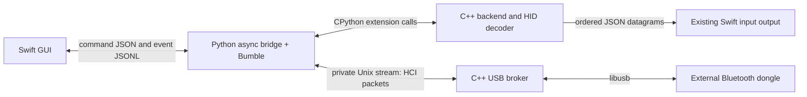

# Native backend and Bumble bridge

The SwiftUI GUI remains Swift. Project-owned USB transport, adapter discovery,
device classification, reconnect decisions, saved-device and bond persistence,
identity generation, diagnostic writes, event-log rotation, CLI pointer output,
and ordered input delivery now execute in C++17. HID descriptor parsing and
field decoding also execute in C++.

Python remains for Bumble's Bluetooth protocols and the asynchronous operations
that invoke them: discovering services, pairing/encryption, GATT subscriptions,
connection cleanup, and A2DP/AVDTP session management. It is bundled in the app.
The legacy raw scanner, firmware diagnostic, build scripts, and tests also remain
Python. This migration does not replace Bumble or claim to eliminate Python.



## Two boundaries

1. **Python to C++, inside the same worker process.** `native_backend.call()`
   marshals dictionaries/lists through a JSON value boundary to
   `_driver_native.execute()`. C++ implements the operation and returns a JSON
   value. Policy errors become `ValueError`, I/O errors become `OSError`, and
   runtime failures become `RuntimeError`. The policy layer does not depend on
   Python types. Native journal, pointer, and sender objects are owned by
   CPython capsules. `_hid_native` accepts report bytes directly for per-report
   decoding; HID bytes do not go through JSON. The sender's retry thread does
   not invoke Python and releases the interpreter lock while draining/closing.

2. **Worker to USB broker, between processes.** The unprivileged Python Bumble
   transport opens `/var/run/raw-bluetooth-UID/usb.sock`, sends one line containing
   a validated `usb:VID:PID`, and waits for `ready` or an error. After that the
   stream contains H4-framed HCI commands, ACL packets, and controller events.
   C++ authenticates the socket's kernel peer UID, validates external topology,
   excludes internal and duplicate controllers, and claims the adapter through
   libusb. It uses asynchronous event/ACL reads and releases transfers and the
   interface when the client disconnects. The service directory is root-owned
   and traversable; its socket is mode 0600 and owned by the installing user.
   Only one client may use the broker at a time. No paths or executable commands
   are accepted from the worker. SCO/ISO microphone transport is unsupported.

For example, when a mouse moves, C++ receives USB bytes and forwards HCI packets
to Bumble. Bumble handles Bluetooth/L2CAP/ATT and delivers a HID notification.
The bridge passes its report bytes to the native decoder, which extracts motion
and button fields. A native sender forwards the decoded JSON report to the
unchanged Swift input server, which posts macOS events under the logged-in user.

## Build and installation

Run `.venv/bin/python native/build.py` after installing the pinned development
dependencies. It builds `_hid_native`, `_driver_native`, and
`build/native/raw-bluetooth-usb`, and copies the pinned libusb runtime. Compilation
targets macOS 13+ and replaces binaries atomically so an already running process
keeps its existing mapped image. The vendored JSON/header versions and licenses
are documented in `native/vendor/README.md`.

`.venv/bin/python packaging/build_release.py` includes these native components,
the Python/Bumble runtime, FFmpeg, and the existing Swift GUI in a signed preview
app and installable DMG. The app is ad-hoc signed, not Developer ID notarized.
No Python or compiler installation is required on the destination Mac.

Install/update USB access once in Settings after upgrading from the Python
broker. Launchd executes the installed **C++ binary directly** as root; Python
does not run in the persistent privileged service. Normal driver sessions need
no administrator prompt. Pairing files retain their existing names and schema.

## Validation

The Python contract suite exercises native discovery policy, HID decoding,
persistence, reconnect policy, event-log rotation, and real native datagram
backpressure. Broker protocol tests run the compiled executable in a mode that
cannot access USB. `native/test_core.cpp` exercises HCI fragmentation and policy
under AddressSanitizer and UndefinedBehaviorSanitizer. Real-hardware validation
must additionally establish HID subscriptions and receive input; scan readiness
alone does not establish that devices work.

Run the standalone sanitizer check with:

```sh
mkdir -p build/native
c++ -std=c++17 -O1 -g -fsanitize=address,undefined -fno-omit-frame-pointer native/test_core.cpp -o build/native/test-core-sanitized
build/native/test-core-sanitized
```
