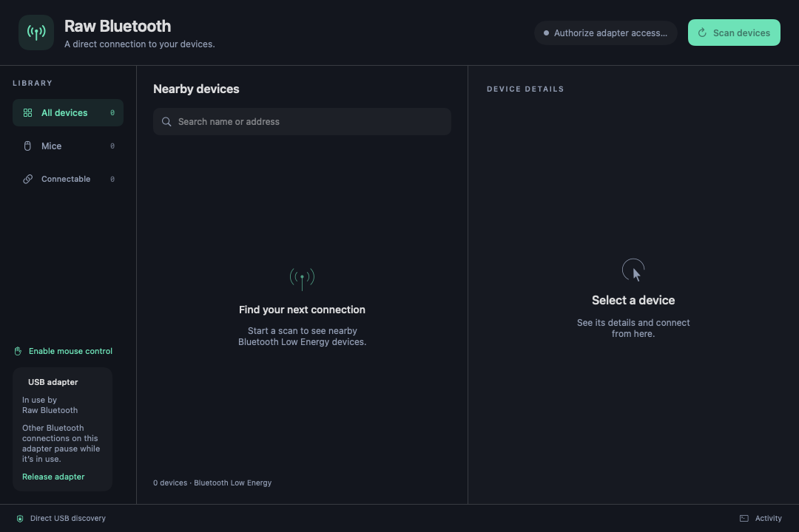

# User guide

Start with the [installation instructions](../README.md#quick-start). Run commands below from the checkout directory. Use one adapter session at a time; release the GUI adapter before running diagnostic or command-line tools.

## Desktop app



*Earlier UI preview: newer keyboard, saved-device, speed, and audio controls are not shown in this capture.*

**Scan devices** starts discovery and requests administrator authentication for USB access. Search by name/address, or use the Mice, Keyboards, Connectable, Audio, and Saved filters. Select an entry to inspect its address, signal, type, and connection availability. A discovery entry alone does not establish that its protocol is supported.

Connect a BLE mouse or keyboard using the corresponding action. A mouse and keyboard can remain connected together. For keyboard pairing, enter the displayed passkey on the keyboard being paired, preserving leading zeroes, then press Enter. The connected keyboard has a local test field. Adjust **Mouse speed** and **Scroll speed** independently; their settings persist across launches.

### Reconnection and forgetting devices

Successful input connections are saved with automatic reconnection enabled by default. The Saved filter and **Reconnect automatically** switch control this preference. On a later launch, saved devices start an adapter session automatically; USB access may still require administrator authentication.

Wake a paired device with normal movement, clicks, or keypresses. It must advertise before reconnection can occur. Avoid holding its pairing button unless re-pairing is intended. An intentional **Disconnect** pauses retries for that device for the session until explicitly reconnected or automatic reconnection is re-enabled. If the device clears its bond or changes identity, pair it manually again. The forget action removes its saved preference and stored bond for that peer.

**Release adapter** ends the session and gives USB back to macOS. Closing the app requests cleanup. A heartbeat lease also ends the backend session after the GUI stops renewing it. Recovery after deep sleep or a USB reset may require releasing and restarting the session, or unplugging and reconnecting the dongle.

### Experimental system audio

The Audio filter includes Bluetooth Classic discovery results. Select a discovered device and choose **Route system audio** to capture the macOS output mix and stream it to an available A2DP SBC sink. A BLE advertisement alone is not enough to establish an A2DP connection; Classic discovery must identify a suitable device. macOS requires Screen & System Audio Recording permission for capture.

The app captures system output and sends it directly over A2DP; the Bluetooth device does not appear as a macOS Sound output. Microphone input and HFP/SCO are not implemented. An audio device appearing in discovery is not confirmation that playback works with it.

## Command-line mouse driver

The separate launcher is for the M196 mouse workflow:

```sh
./'Start M196 Driver.command'
```

It starts an unprivileged pointer helper, requests administrator authentication for the Bluetooth process, and runs for up to 24 hours. Ctrl-C requests cleanup. In another Terminal, or by double-clicking the file, stop with:

```sh
./'Stop M196 Driver.command'
```

The launcher writes `driver-live.log`. The CLI input helper needs Accessibility permission for its Python host; GUI permission does not grant permission to the separate helper.

### Inspect reports without moving the cursor

```sh
sudo .venv/bin/python -u m196_driver.py --dry-run
```

Put the M196 into pairing mode. The driver selects connectable advertisements with `M196` in the name, pairs/encrypts, reads the HID descriptor, and subscribes to reports. Use `--address ADDRESS` to restrict the candidate. This mode prints mouse report data.

### Forward mouse input manually

Run the helper as your normal logged-in user in Terminal 1:

```sh
.venv/bin/python -u pointer_bridge.py --duration 3660
```

From the same checkout in Terminal 2:

```sh
sudo .venv/bin/python -u m196_driver.py --event-socket "$PWD/pointer.sock" --duration 3600
```

The privileged Bluetooth process sends decoded reports to the normal user's helper over an owner-restricted Unix socket. Running pointer output directly as root can be denied even if your normal user has Accessibility permission.

Request the CLI Accessibility prompt with:

```sh
.venv/bin/python m196_driver.py --request-accessibility
```

### Mouse driver options

| Option | Default / behavior |
| --- | --- |
| `--transport` | `auto`; detect one external standard USB HCI controller, or select `usb:VID:PID` |
| `--address` | Restrict the mouse address; otherwise match its advertised name |
| `--dry-run` | Print reports without posting pointer events |
| `--scan-timeout` | 60 seconds |
| `--duration` | 300 seconds maximum session length |
| `--once` | Exit after the first disconnection |
| `--event-socket` | Forward reports to an unprivileged helper |
| `--stop-file` | Stop when this file appears |
| `--request-accessibility` | Request permission and exit |

Use `.venv/bin/python m196_driver.py --help` for the executable reference. The desktop app has its own session lifecycle and no fixed session timer.

## Diagnostic tools

Direct USB HCI BLE scan, without Bumble or CoreBluetooth:

```sh
sudo .venv/bin/python -u raw_scan.py --seconds 45
```

The scanner also accepts `--vid` and `--pid` as integers, such as `0x0a12` and `0x0001`. An override does not establish compatibility with a different controller.

Experimental Classic audio discovery and test-tone session:

```sh
sudo .venv/bin/python -u audio_cli.py --timeout 45
```

This CLI currently targets AirPods discovery and accepts `--transport` (default `auto`). The timeout bounds discovery; use Ctrl-C to stop playback. It is a diagnostic tool, not a general audio player.

## Selecting another USB Bluetooth adapter

The desktop app and mouse/audio CLIs detect one external standard USB HCI adapter automatically. In **Settings → USB adapter**, leave the field blank for automatic selection or enter a USB ID such as `0bda:8771` to choose a detected controller. Release an active session before changing the selection. With multiple adapters, choose one explicitly; identical VID/PID duplicates must be unplugged until only one remains.

For a source checkout, pass the chosen ID to the backend or either CLI:

```sh
sudo .venv/bin/python -u m196_driver.py --transport usb:VID:PID --dry-run
```

Replace `VID:PID` with your adapter's four-digit hexadecimal USB vendor and product IDs. Selection verifies the external USB topology and standard HCI event/ACL endpoints. Internal, unavailable, and nonstandard devices are rejected. Vendor firmware loading is not provided; a detected controller can still fail initialization. CSR `0a12:0001` remains the only hardware-verified adapter. Audio additionally requires BR/EDR/A2DP capability; a BLE-only dongle cannot provide it.
